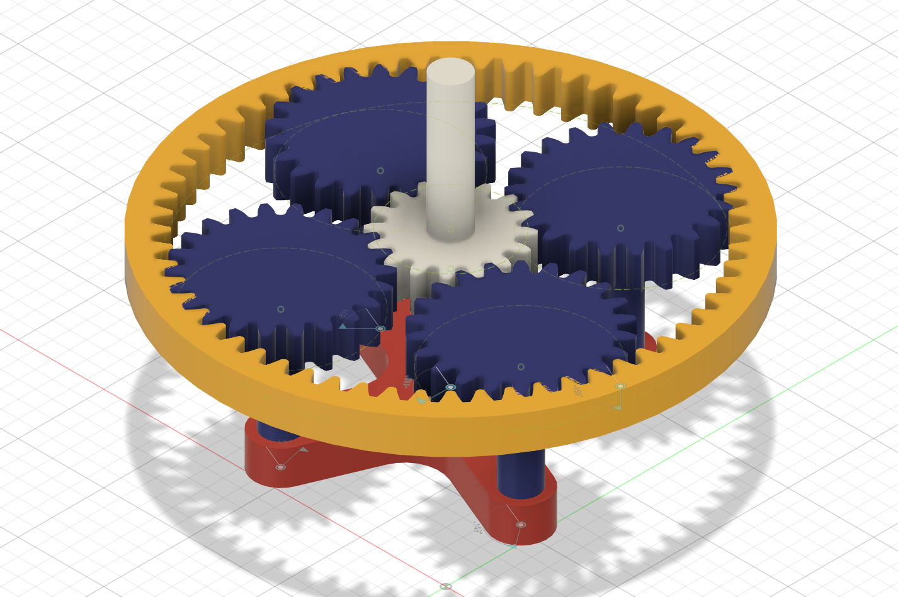
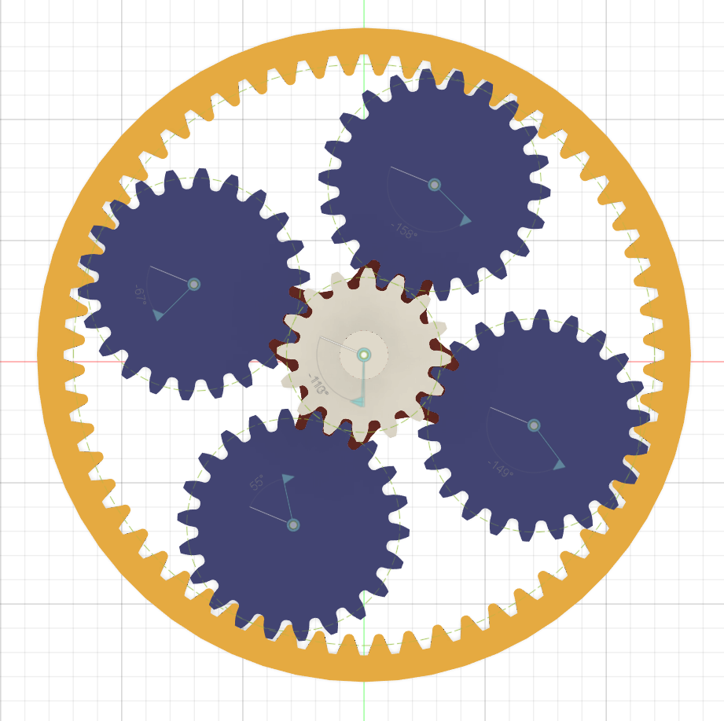
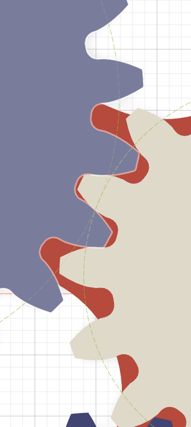
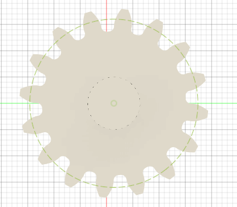
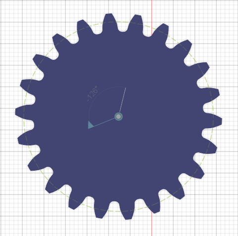
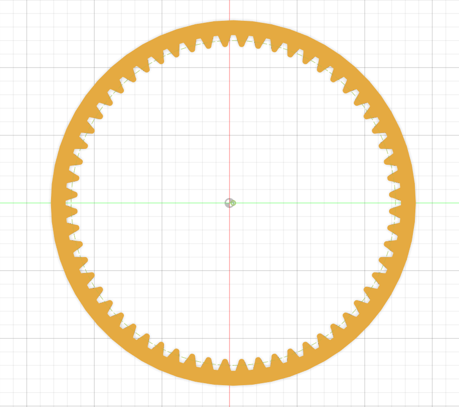
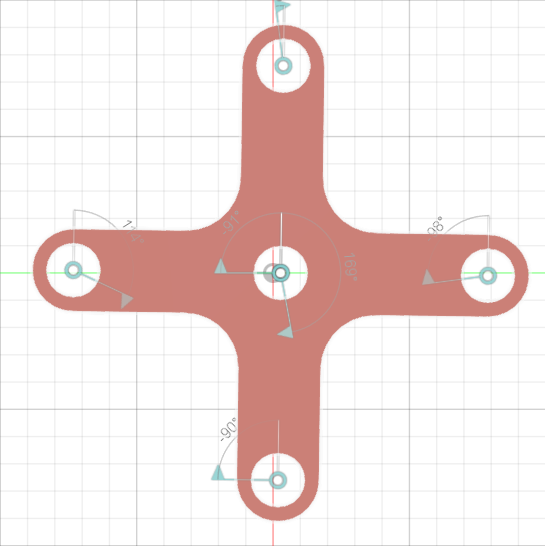

# Planetary Gear Mechanism — CAD Design

A planetary gear mechanism designed in **Autodesk Fusion 360**, featuring a central sun gear, four planet gears, an internal ring gear, and a planet carrier. The project includes detailed component models, assembly views, and motion links to explore the mechanism's movement.

## Project Overview

This project focuses on the 3D CAD modelling and assembly of a planetary gear system. The motion links allow the connected components to move together, making it easier to visualize how the gears interact.

**Project status:** CAD model only. Physical fabrication and experimental testing have not been performed.

## Gear Specifications

| Parameter | Specification |
|---|---:|
| Sun gear teeth | 16 |
| Planet gear teeth | 22 |
| Ring gear teeth | 60 |
| Gear module | 2 |
| Number of planet gears | 4 |
| CAD software | Autodesk Fusion 360 |
| Native project archive | `PLANETARY GEAR.f3z` |

The tooth counts satisfy the standard geometric relationship for a simple planetary gear set with a common module:

\[
N_r = N_s + 2N_p
\]

\[
60 = 16 + 2(22)
\]

where \(N_r\), \(N_s\), and \(N_p\) represent the ring, sun, and planet gear tooth counts, respectively.

## CAD Assembly

### Complete Assembly

### Top View

### Gear Meshing

## Individual Components

### Sun Gear

The central gear that meshes externally with the planet gears.

### Planet Gear

The planet gears mesh with the sun gear and the internal ring gear.

### Ring Gear

The internal gear surrounding the planet gears.

### Planet Carrier

The carrier supports the planet gears and governs their orbital movement as part of the planetary mechanism.

## Motion and Kinematics

The assembly includes motion links to demonstrate coordinated component movement and visualize the planetary gear mechanism's kinematics.

The relative angular velocities depend on the operating configuration: which component is fixed, which is driven, and which serves as the output. For a simple planetary gear set, the relationship is:

Ns(ωs − ωc) + Nr(ωr − ωc) = 0

Where:
Ns = Number of teeth on the sun gear (16)
Nr = Number of teeth on the ring gear (60)
ωs = Angular velocity of the sun gear
ωr = Angular velocity of the ring gear
ωc = Angular velocity of the planet carrier
ω means angular velocity (rotational speed), usually measured in RPM or rad/s.

This relationship can be used to analyse the mechanism's speed ratios for different input and output configurations. A specific velocity increase or reduction ratio is not claimed here because the operating configuration has not been specified.

## Tools Used

- Autodesk Fusion 360
- 3D parametric CAD modelling
- Gear geometry and planetary mechanism assembly
- Motion links for component movement

## Project Files

- **`PLANETARY GEAR.f3z`** — Fusion 360 design archive.
- **`images/`** — Assembly views and individual component screenshots.

Open the design archive in Autodesk Fusion 360 to inspect the model and explore its assembly and motion links.

## Scope and Limitations

This repository presents a CAD design and visual kinematic exploration. The model has not been physically manufactured or experimentally validated, and no load-capacity, efficiency, durability, or measured performance claims are made.
